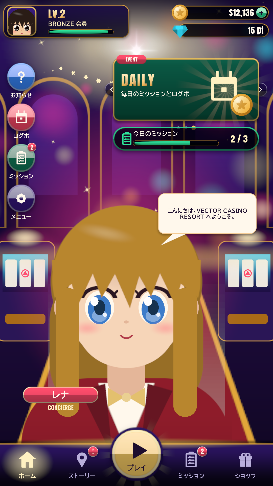
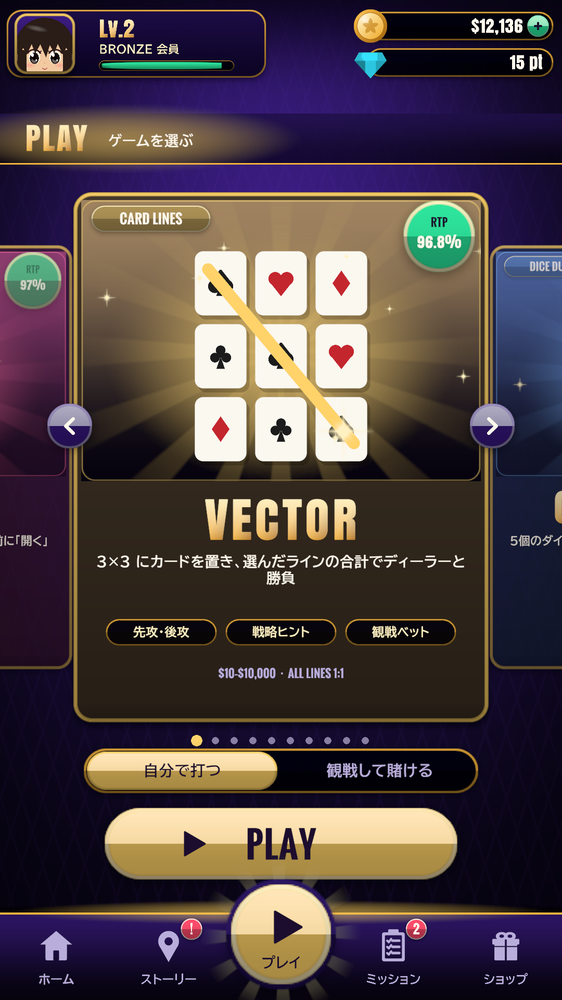
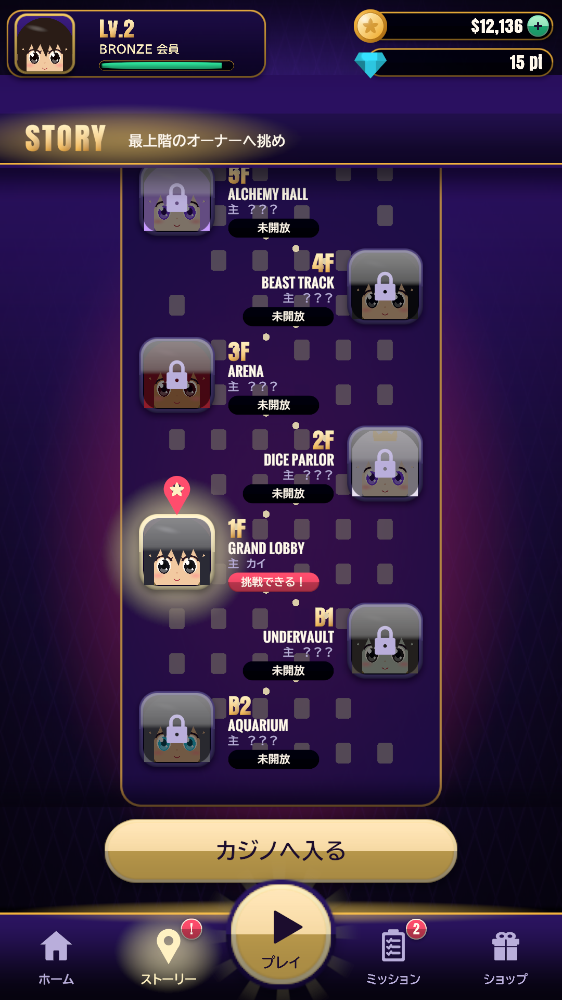
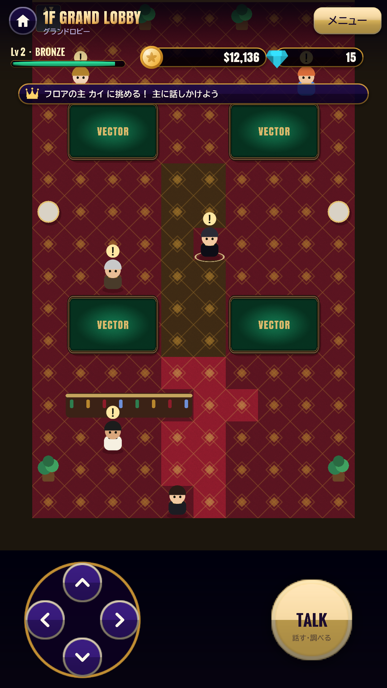
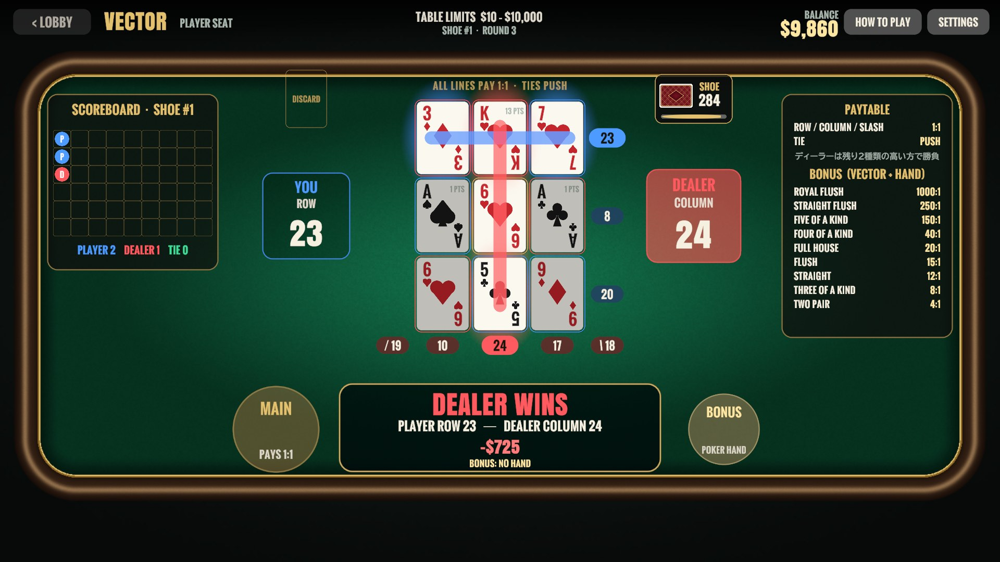
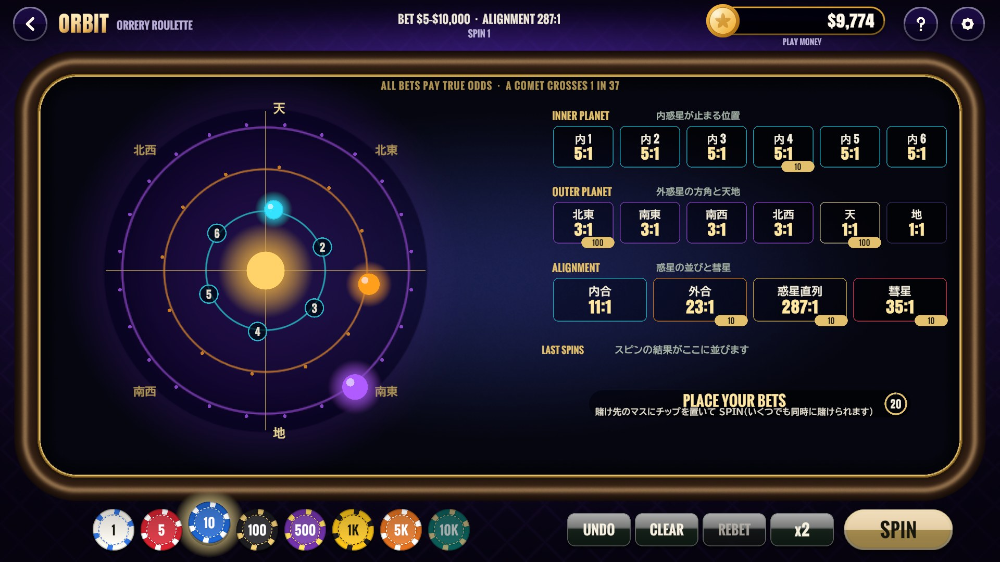
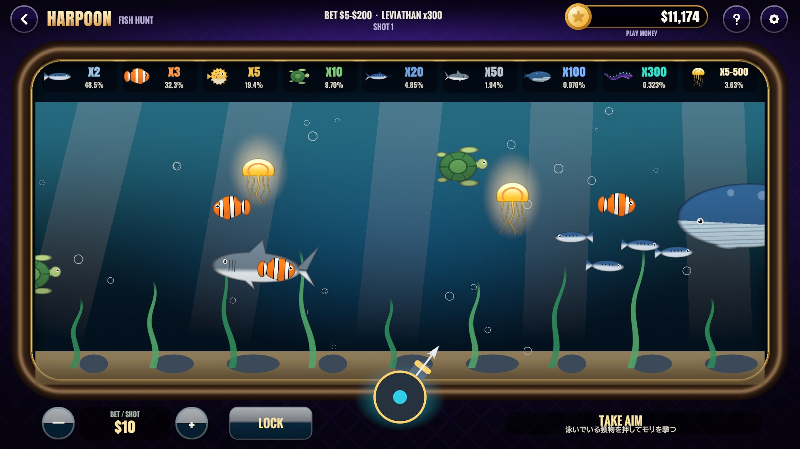

# VECTOR CASINO RESORT — 設計ドキュメント

> **確率をすべて公開した、正直なカジノ。** 10 のオリジナルのカジノゲームと、カジノの塔を登るストーリーモード（カジノ RPG）を
> Unity 6 / C# で開発。すべての配当を全列挙・動的計画法で検証し、最善を尽くしてもハウスがわずかに有利になるよう設計した。

<table>
<tr>
<td width="20%"></td>
<td width="20%"></td>
<td width="20%"></td>
<td width="20%"></td>
<td width="20%"></td>
</tr>
</table>
<table>
<tr>
<td width="33%"></td>
<td width="33%"></td>
<td width="33%"></td>
</tr>
<tr>
<td align="center">VECTOR（カード × ライン）</td>
<td align="center">ORBIT（天球儀 × ルーレット）</td>
<td align="center">HARPOON（狩り × リアルタイム）</td>
</tr>
</table>

## プロジェクト概要

| 項目 | 内容 |
|---|---|
| 種別 | スマートフォンゲーム（個人開発） |
| 対応 | Android（API 36・ARM64）／ Windows |
| 担当・進め方 | 企画・ゲームデザイン・数理設計・UI・テスト・ストア準備を 1 人で担当。実装とドキュメント作成には生成 AI（Claude Code）を活用し、仕様決め・設計の判断・レビュー・テストでの検証は自分で行った |
| 開発時期 | 2025 年 4 月に原型（14 日間）、2026 年 10 月に全面的に作り直し（コミットの記録: 2026/10/21〜10/22） |
| 公開状況 | 未公開（Google Play での公開を準備中） |
| 規模 | C# 371 ファイル・約 28,000 行 ＋ テスト・ツール 約 4,300 行 ／ 12 シーン ／ 10 ゲーム |

### 技術スタック

| 分類 | 技術 |
|---|---|
| エンジン / 言語 | Unity 6（6000.6.6f1）/ C# |
| UI | uGUI / TextMesh Pro（画像・プレハブを使わずコードで生成） |
| テスト | NUnit（Unity Test Runner 152 件 ／ .NET 単体 137 件） |
| 検証ツール | .NET 8 の自作シミュレーター（厳密計算・モンテカルロ） |
| CI | GitHub Actions（Unity なしで Core のテストと全ゲームの RTP 検証） |
| 配布 | Android App Bundle（IL2CPP）、署名鍵は環境変数で渡しリポジトリに置かない |

---

## このプロジェクトで伝えたいこと

### 1. 数学でゲームを設計した

「楽しい」だけでなく「カジノとして成立する」ことを、**数学で証明してから**配当を決めました。

| ゲーム | 手法 | 結果 |
|---|---|---|
| VECTOR BONUS | 6 デッキの 5 枚の組み合わせ約 2.4×10¹⁰ 通りを全列挙 | RTP 95.654% |
| CROWN DICE | 252 通りの手 × 462 通りの残し方を後ろ向き帰納で解く | RTP 96.852%（厳密な最善手） |
| COLOSSEUM / SUGOROKU | 全状態を動的計画法で解く | 96.712% / 96.493% |
| DERBY | 残りカードから着順の確率をメモ化再帰で厳密計算（1 レース約 2ms） | オッズを確率から自動生成 |
| ORBIT / HARPOON / HANABI | 確率の解析と全数え上げ | どの賭け方でも RTP が同じになるよう設計 |

初版の VECTOR は、上手に打つと **RTP が 160% を超える**（プレイヤーが勝ち続ける）ことをシミュレーションで発見し、ルール（「残り 2 種類の高い方」）とディーラーの手順（ハウスウェイ）を作り直して、**最善手でもハウスエッジ約 3%** に調整しました。この検証は CI でプッシュごとに回っています（→ [テスト仕様・結果](test-report.md)）。

### 2. ルールを Unity から切り離した

ゲームのルール・賭け金・RPG の規則を **Unity に依存しない `Vector.Core`** にまとめました。そのおかげで、

- Unity なしでテストでき、CI が数十秒で終わる
- ゲームと**同じコード**をシミュレーターで何億回も回して配当を検証できる
- AI の先読みをワーカースレッドで計算しても安全（60fps を保つ）

### 3. 10 ゲームが同じ土台を共有する

全ゲームの進行を `CasinoDirector` の**テンプレートメソッド**にまとめ、各ゲームは `PlayRound` などを実装するだけで、ベット受付・精算・返金・離席・リアリティチェック・フロアの主の挑戦を受け継ぎます。所持金と挑戦用チップは `ITableWallet` で差し替えられるので、挑戦モードでもテーブルのコードは変わりません（→ [設計書 2 章](design.md#2-設計方針solidkissyagnidry)）。

### 4. お金を扱うソフトウェアとしての堅牢さ

- 1 ラウンドを例外から守り、障害時は勝負を無効にして**必ず返金**。アプリが落ちても次の起動時に返金
- セーブデータは HMAC-SHA256 で改ざん検知、一時ファイル経由の原子的な書き込み、1 世代バックアップから自動復旧
- 暗号論的乱数と Fisher–Yates、残高・リミットの検証

### 5. 素材を持たないゲーム

UI・カード・ダイス・キャラクターの立ち絵・効果音まで**すべてコードで生成**しています（画像やプレハブを持たない）。日本語フォントは使う文字だけを焼き込み、文言が増えると自動で作り直します。どの端末でも同じ見た目になるよう、基準解像度の枠を安全領域に合わせて拡大縮小しています。

---

## 技術的な課題と解決

| 課題 | 解決 |
|---|---|
| 初版はプレイヤーが有利すぎる（RTP 160% 超） | シミュレーターで発見 → ルールとハウスウェイを再設計し、厳密値・シミュレーションで再検証 |
| 1,300 行の `gameManager` に処理が集中 | Core / Runtime に分割、1 ファイル 1 型、テンプレートメソッドで共通化 |
| 所持金がマイナスになる・引き分けの精算ミス | `Bankroll` / `WagerSession` で検証、精算を `Settlement` に一本化 |
| AI の先読みで描画が止まる | Core を Unity 非依存にしてワーカースレッドで計算 |
| 端末ごとに画面の大きさ・余白が違う | 安全領域いっぱいの枠に基準解像度を収める `ScreenFrame` |
| 端末のフォントによって日本語の見た目が変わる | 使う文字だけを焼き込んだ静的フォントを同梱＋焼き込み漏れの網羅テスト |
| 勝負中にアプリが落ちると賭け金が消える | `pendingStake` を記録し、次の起動時に返金 |

---

## ドキュメント一覧

| ドキュメント | 内容 |
|---|---|
| [企画・要件定義書](requirements.md) | 背景・コンセプト・機能要件（10 ゲーム）・非機能要件・責任あるゲーミング・旧版からの改善 |
| [画面定義書](screen-definitions.md) | 画面一覧と、ホーム・テーブル・フロアの表示項目／操作／業務ルール |
| [設計書](design.md) | 構成・設計方針（SOLID）・クラス図・シーケンス図・状態遷移図・セーブデータ・堅牢性 |
| [テスト仕様・結果](test-report.md) | 単体テスト 137 件の実行結果と、全ゲームの RTP 検証結果 |
| [diagrams/](diagrams/) | PlantUML ソース（`src/`）と SVG（`svg/`） |
| [screenshots/](screenshots/) ／ [../Store/screenshots/](../Store/screenshots/) | 主要画面 |

### 図の一覧

| 図 | PlantUML | SVG |
|---|---|---|
| ユースケース図 | [usecase.puml](diagrams/src/usecase.puml) | [usecase.svg](diagrams/svg/usecase.svg) |
| システム構成図 | [architecture.puml](diagrams/src/architecture.puml) | [architecture.svg](diagrams/svg/architecture.svg) |
| クラス図① テーブルの共通基盤 | [class-casino.puml](diagrams/src/class-casino.puml) | [class-casino.svg](diagrams/svg/class-casino.svg) |
| クラス図② VECTOR のルールエンジン | [class-vector-core.puml](diagrams/src/class-vector-core.puml) | [class-vector-core.svg](diagrams/svg/class-vector-core.svg) |
| クラス図③ ストーリーモードとセーブ | [class-rpg.puml](diagrams/src/class-rpg.puml) | [class-rpg.svg](diagrams/svg/class-rpg.svg) |
| シーケンス図① 1 ラウンド | [seq-round.puml](diagrams/src/seq-round.puml) | [seq-round.svg](diagrams/svg/seq-round.svg) |
| シーケンス図② VECTOR の勝負 | [seq-vector-round.puml](diagrams/src/seq-vector-round.puml) | [seq-vector-round.svg](diagrams/svg/seq-vector-round.svg) |
| シーケンス図③ 主への挑戦 | [seq-challenge.puml](diagrams/src/seq-challenge.puml) | [seq-challenge.svg](diagrams/svg/seq-challenge.svg) |
| シーケンス図④ セーブと復旧 | [seq-save.puml](diagrams/src/seq-save.puml) | [seq-save.svg](diagrams/svg/seq-save.svg) |
| 状態遷移図 VECTOR のラウンド | [state-vector-round.puml](diagrams/src/state-vector-round.puml) | [state-vector-round.svg](diagrams/svg/state-vector-round.svg) |
| 画面遷移図 | [screen-transition.puml](diagrams/src/screen-transition.puml) | [screen-transition.svg](diagrams/svg/screen-transition.svg) |

SVG の再生成：

```bash
cd Doc/diagrams/src
java -jar plantuml.jar -charset UTF-8 -tsvg -o ../svg *.puml
```
