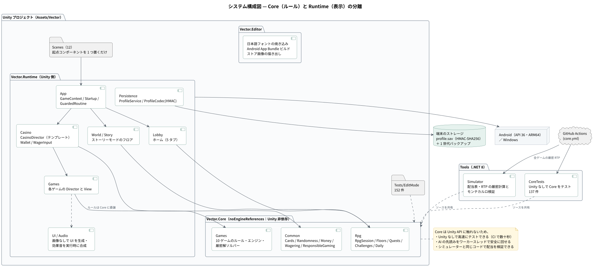
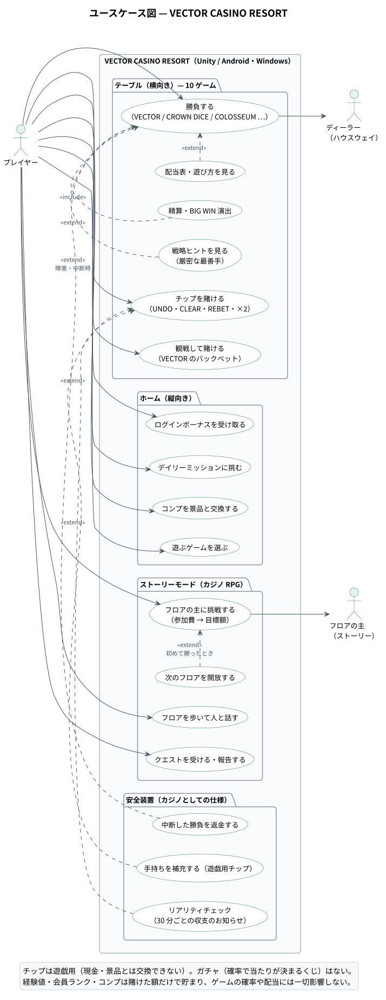
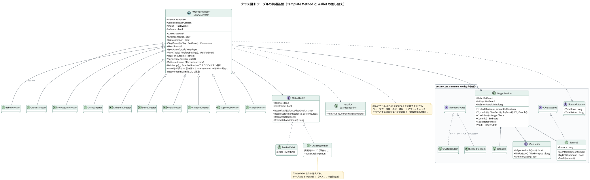
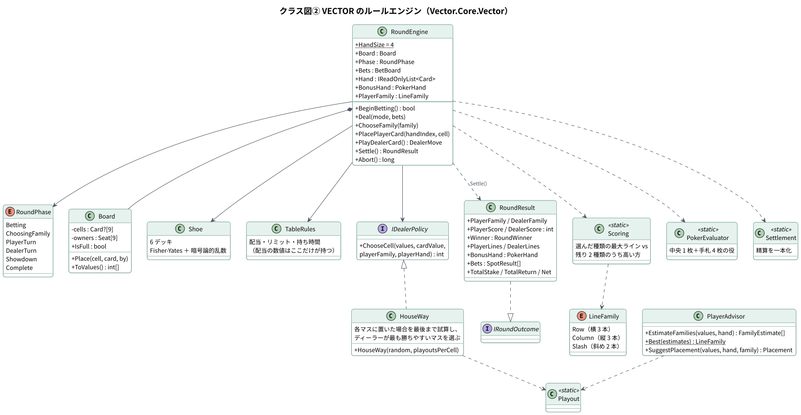
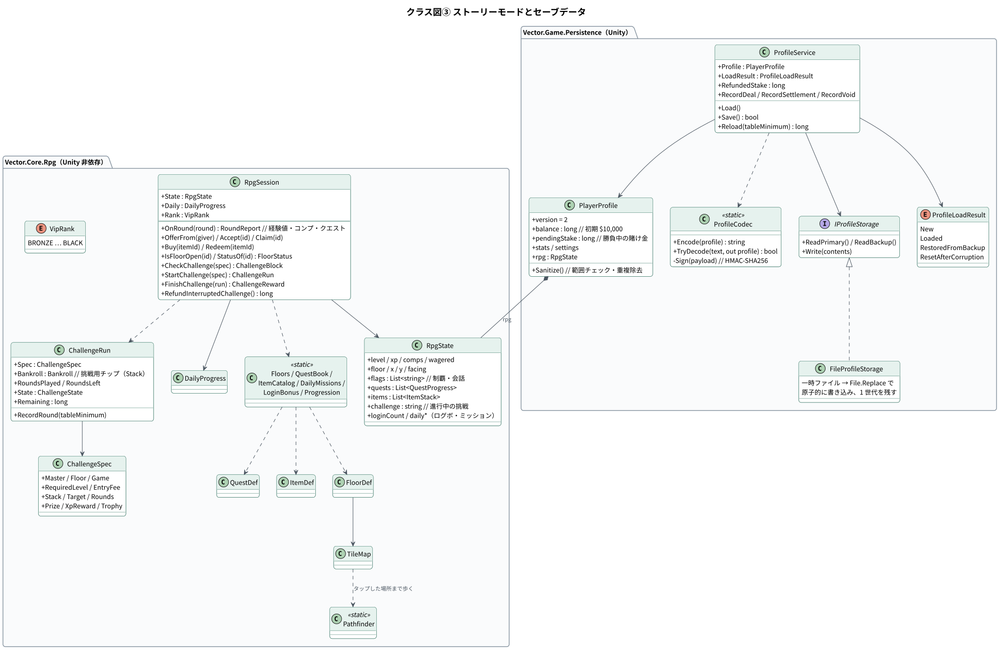
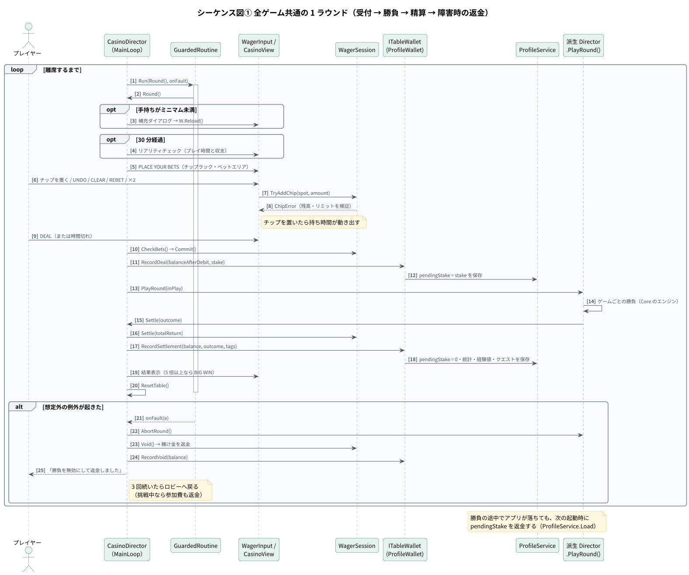
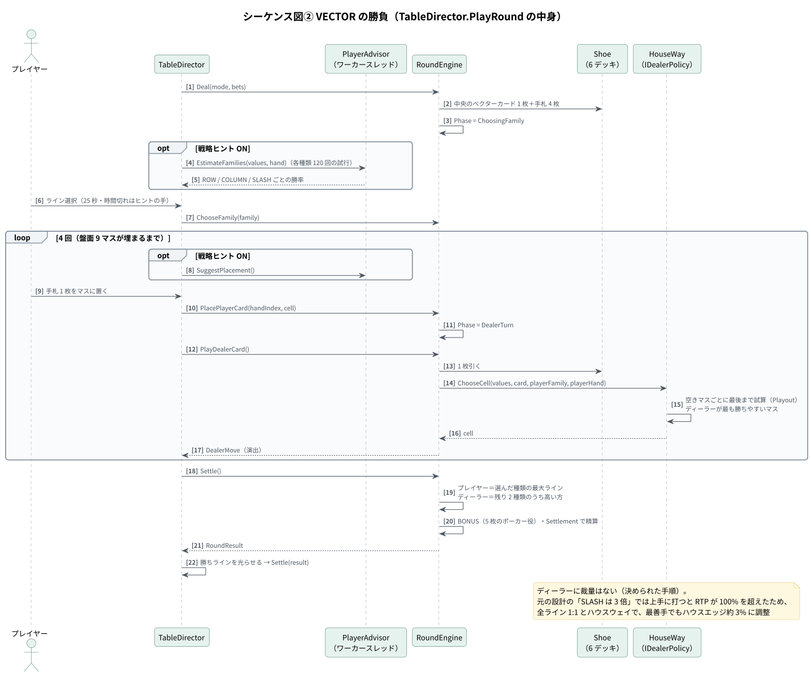
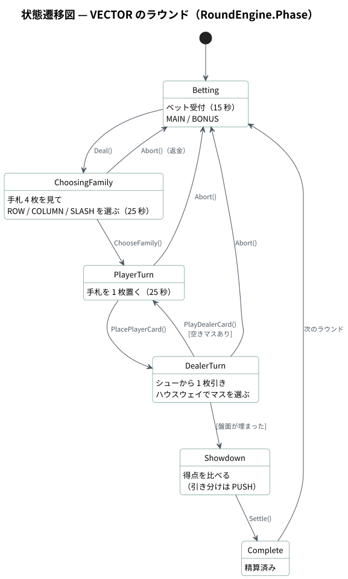
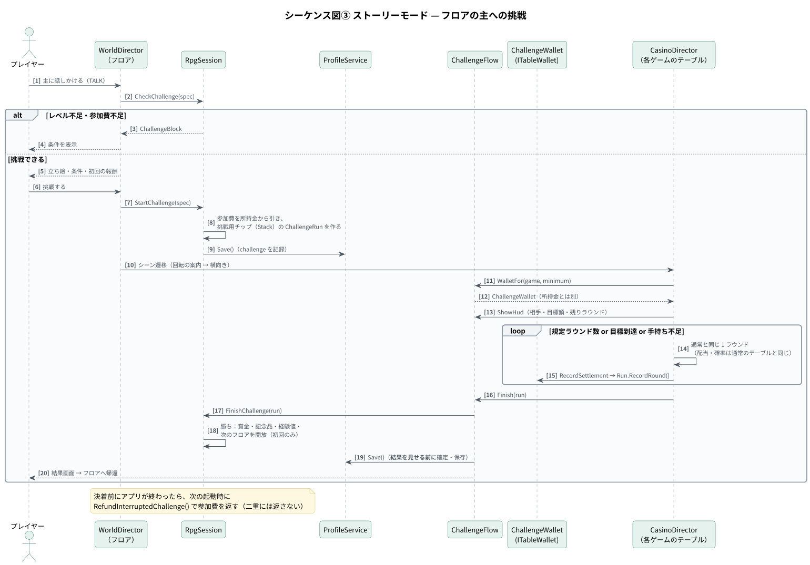
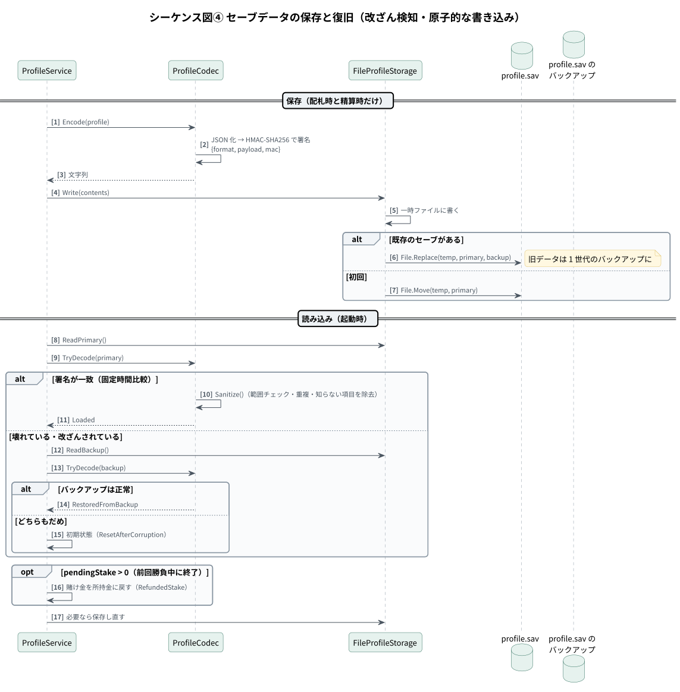

# 設計書 — VECTOR CASINO RESORT

1. [システム構成](#1-システム構成)
2. [設計方針（SOLID・KISS・YAGNI・DRY）](#2-設計方針solidkissyagnidry)
3. [クラス図](#3-クラス図)
4. [シーケンス図・状態遷移図](#4-シーケンス図状態遷移図)
5. [データ設計（セーブデータ）](#5-データ設計セーブデータ)
6. [堅牢性・運用性](#6-堅牢性運用性)
7. [ディレクトリ構成](#7-ディレクトリ構成)

図の PlantUML ソースは [`diagrams/src/`](diagrams/src/)、SVG は [`diagrams/svg/`](diagrams/svg/) にあります。

---

## 1. システム構成



| アセンブリ | 名前空間 | 役割 | Unity への依存 |
|---|---|---|---|
| Vector.Core | `Vector.Core.*` | 10 ゲームのルール・エンジン・厳密解ソルバー、賭け金、RPG の規則 | **なし**（`noEngineReferences`） |
| Vector.Runtime | `Vector.Game.*` | 画面・進行役・演出・セーブ・効果音 | あり |
| Vector.Editor | — | 日本語フォントの焼き込み、Android App Bundle のビルド、ストア画像の描き出し | エディタのみ |
| Tools/Simulator | — | 配当表と RTP の厳密計算・シミュレーション（.NET 8） | なし（Core のソースを共有） |
| Tools/CoreTests | — | Unity なしで Core をテスト（NUnit） | なし（同上） |

**Core を Unity から切り離した効果**

- Unity のライセンスなしで、CI がプッシュごとに数十秒でテストと RTP 検証を回せる
- AI の先読み（ハウスウェイ・戦略ヒント）を**ワーカースレッド**で計算でき、描画を止めない
- 実際のゲームと**同じコード**をシミュレーターで何億回も回して配当を検証できる

### ユースケース



---

## 2. 設計方針（SOLID・KISS・YAGNI・DRY）

| 原則 | 具体例 |
|---|---|
| 単一責任 | ルール（各 `*Engine`）・賭け金（`WagerSession`）・進行（`*Director`）・画面配置（`*View`）・文言（`Labels` / `StoryNames` / `Cast`）を分離。会話の流れ（`Conversation`）と規則の判断（`RpgSession`）も別 |
| 開放閉鎖 | 全ゲームの進行は `CasinoDirector` のテンプレートメソッド。新しいゲームは `PlayRound` などを実装するだけで、ベット受付・精算・返金・離席・挑戦を受け継ぐ |
| リスコフの置換 | 所持金と挑戦用チップは `ITableWallet`（`ProfileWallet` / `ChallengeWallet`）を入れ替えても、テーブルはそのまま動く |
| インターフェース分離 | `IBetLimits`・`IChipAccount`・`IRoundOutcome`・`IRandomSource` などはメソッド 1〜4 個の最小構成 |
| 依存性逆転 | エンジンは乱数・リミット・ディーラー方針を抽象で受け取り、組み立ては各シーンの起点（コンポジションルート）だけが行う |
| KISS | 画像やプレハブを持たず、UI・カード・ダイス・キャラクター・効果音をコードで生成。DI コンテナやイベントバスは導入しない |
| YAGNI | 使わない機能・メンバーは置かない。不要な using・使われないメンバーはビルドで検出 |
| DRY | 配当の数値は各ゲームの `*Rules` だけが持ち、配当表・ヘルプ・フェルトの印字はそこから生成 |

---

## 3. クラス図

### 3-1. テーブルの共通基盤



### 3-2. VECTOR のルールエンジン



### 3-3. ストーリーモードとセーブデータ



---

## 4. シーケンス図・状態遷移図

### 4-1. 全ゲーム共通の 1 ラウンド



### 4-2. VECTOR の勝負



### 4-3. VECTOR のラウンドの状態遷移



### 4-4. フロアの主への挑戦



### 4-5. セーブデータの保存と復旧



---

## 5. データ設計（セーブデータ）

保存先は端末内のファイル（`profile.sav` と 1 世代のバックアップ）だけで、**通信は一切行いません**（Android の権限も要求しない）。

```json
{
  "format": 1,
  "payload": "{\"version\":2,\"balance\":10000,\"pendingStake\":0,\"stats\":{…},\"settings\":{…},\"rpg\":{…}}",
  "mac": "HMAC-SHA256(payload) の 16 進文字列"
}
```

| 項目 | 型 | 説明 |
|---|---|---|
| `version` | int | プロファイルの版（2） |
| `balance` | long | 所持金（遊戯用チップ。初期 $10,000、上限 1 兆） |
| `pendingStake` | long | **勝負中の賭け金**。配札時に記録し、精算・返金で 0 に戻す。0 でないまま起動したら返金 |
| `stats` | ProfileStats | 勝敗・引き分けの数、累計の賭け金と払い戻し、最大の勝ち、補充回数、ゲームごとの集計（`GameStats`） |
| `settings` | ProfileSettings | 効果音の音量・高速ディール・戦略ヒント |
| `rpg.level` / `xp` / `comps` / `wagered` | int / long | レベル・経験値・コンプ・累計の賭け金 |
| `rpg.floor` / `x` / `y` / `facing` | int | ストーリーモードの現在地 |
| `rpg.flags` | string[] | 制覇した主・会話の進み具合 |
| `rpg.quests` / `items` | QuestProgress[] / ItemStack[] | クエストと持ち物 |
| `rpg.challenge` | string | 進行中の挑戦（中断時の返金用） |
| `rpg.loginCount` / `lastLoginDay` / `daily*` | | ログインボーナスとデイリーミッション |

| 方針 | 内容 |
|---|---|
| 改ざん・破損の検知 | HMAC-SHA256 で署名し、固定時間で比較 |
| 原子的な書き込み | 一時ファイルに書いてから `File.Replace` で入れ替え、旧データを 1 世代残す |
| 自動復旧 | 本体が読めなければバックアップから、どちらもだめなら初期状態（理由をお知らせ） |
| 値の検査 | 読み込んだ値は範囲チェックし、重複したクエストや知らない項目は取り除く（`Sanitize`） |
| 書き込み頻度 | 配札時と精算時だけ（旧版の「毎フレームのセーブ」を廃止） |

---

## 6. 堅牢性・運用性

| 項目 | 実装 |
|---|---|
| フェイルセーフ | 1 ラウンドを `GuardedRoutine` で包み、想定外の例外でも固まらず、勝負を無効にして返金。3 回続いたら離席（挑戦中なら参加費も返金） |
| 主の挑戦 | 決着はテーブルを離れる前に確定して保存。決着前に終了したら次の起動時に参加費を返す（二重には返さない） |
| 乱数 | カード・ダイス・扉・スロットは暗号論的乱数（`RandomNumberGenerator`）。AI の先読みだけ速さ優先のシード付き乱数 |
| スレッド | AI の先読みはワーカースレッド。Core は Unity API に触れないのでスレッド安全 |
| 静的解析 | `.editorconfig` で不要な using・未使用メンバーを警告、Tools のビルドは警告をエラー扱い |
| CI | GitHub Actions で Core のテスト・厳密に計算できるゲームの RTP・スロットと挑戦のシミュレーション |
| ログ | `Log.Info` はリリースビルドでコンパイル時に除去 |
| 日本語フォント | 画面の文言に使う文字だけを焼き込んだ静的フォント。文言が増えるとエディタ起動時とビルド前に自動で作り直し、漏れはテストで検出 |
| 画面の大きさ | 安全領域いっぱいの枠に基準解像度が収まる倍率で配置。どの端末でも部品の大きさと配置が同じ |
| 責任あるゲーミング | テーブルリミット、30 分ごとのリアリティチェック、遊戯用チップの明記、ガチャなし |

---

## 7. ディレクトリ構成

```
Assets/Vector/
├── Scripts/
│   ├── Core/              Vector.Core（Unity 非依存のルールエンジン）
│   │   ├── Common/        Cards / Randomness / Money / Wagering / ResponsibleGaming
│   │   ├── Games/         Vector / Crown / Colosseum / Derby / Delve / Alchemia / Orbit / Harpoon / Sugoroku / Hanabi
│   │   └── Rpg/           RpgSession / RpgState / Progress / Quests / Items / Floors / Challenges / Daily
│   ├── Runtime/           Vector.Runtime（Unity 側）
│   │   ├── App/           GameContext / GameCatalog / Startup / GuardedRoutine / Log
│   │   ├── Casino/        CasinoDirector / CasinoView / WagerInput / Wallet / ChallengeFlow / Views
│   │   ├── Games/         ゲームごとの Director と View
│   │   ├── World/ Story/  ストーリーモード
│   │   ├── Lobby/         ホーム（5 タブ）
│   │   ├── Persistence/   PlayerProfile / ProfileService / ProfileCodec / FileProfileStorage
│   │   ├── Audio/         Sfx / SfxSynth（実行時に合成）
│   │   └── UI/            Foundation / Art / Effects / Widgets
│   └── Editor/            日本語フォントの焼き込み・ビルド
├── Tests/EditMode/        152 件
├── Scenes/                12 シーン（起点コンポーネントを 1 つ置くだけ）
└── Fonts/                 Anton / Oswald / BIZ UDPGothic（SIL OFL）
Tools/
├── Simulator/             配当表・挑戦の検証ツール（.NET 8）
└── CoreTests/             Unity なしで Core のテスト（CI 用）
Store/                     Google Play の掲載文・プライバシーポリシー・画像
```

C# 371 ファイル・約 28,000 行（`Scripts/`）、テストとツール 約 4,300 行。
