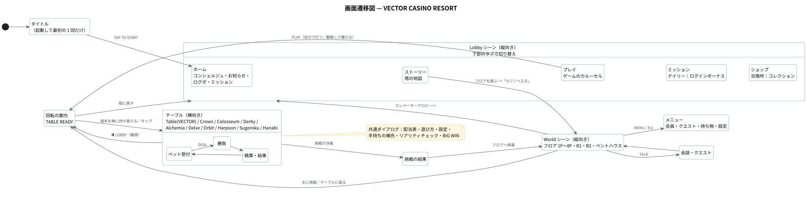
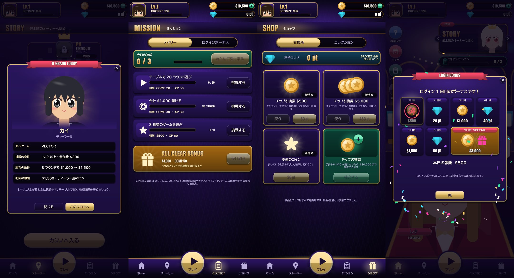
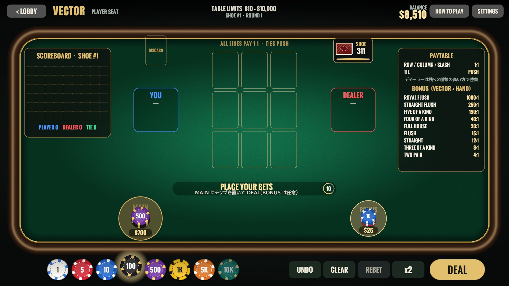
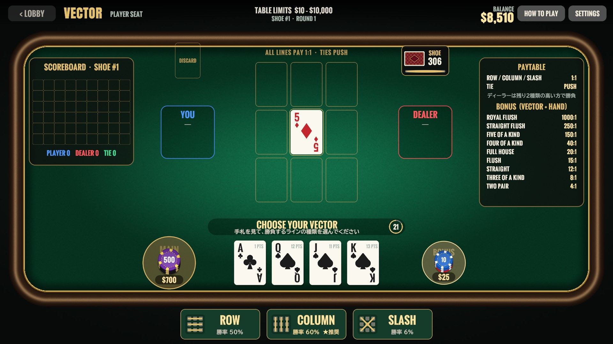
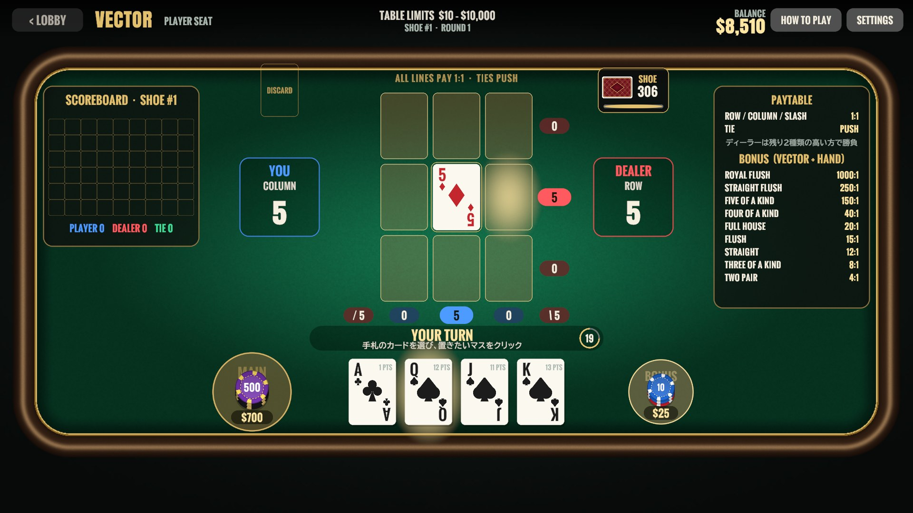
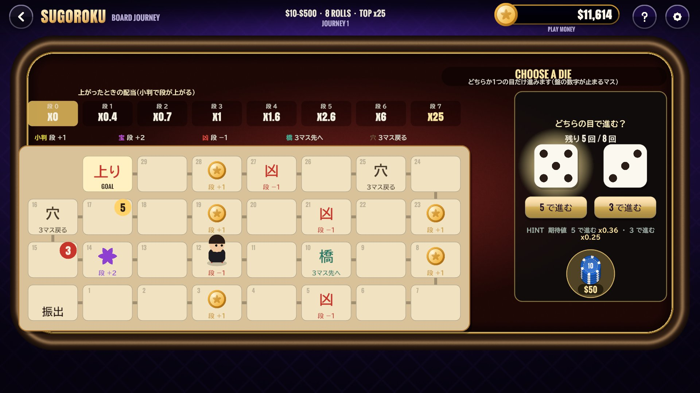
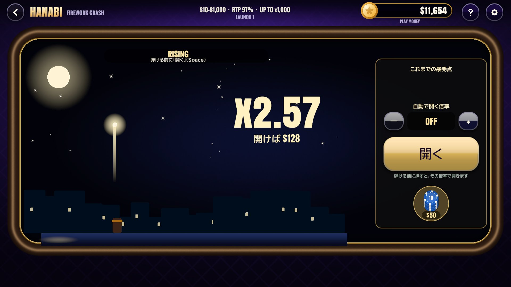
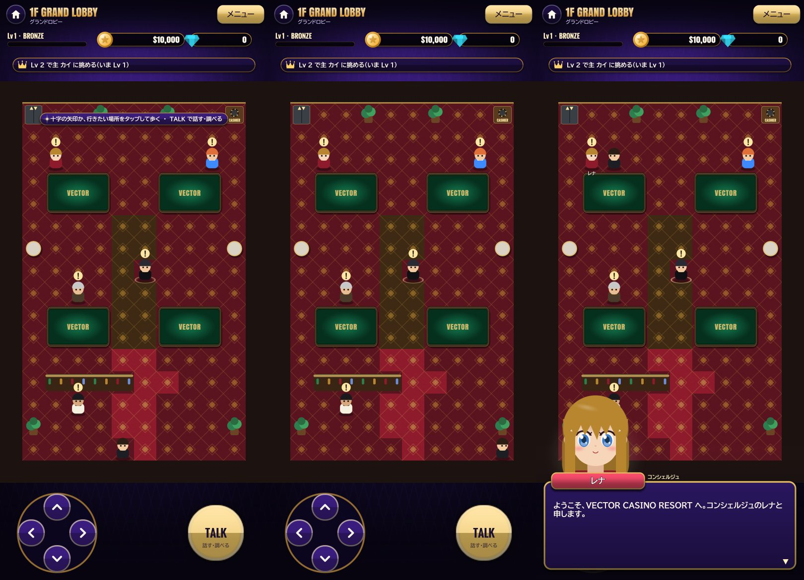

# 画面定義書 — VECTOR CASINO RESORT

| 項目 | 内容 |
|---|---|
| 対象 | VECTOR CASINO RESORT v1.0.0（Unity 6 / Android・Windows） |
| シーン | 12（Lobby・World・テーブル 10） |
| 画面の向き | ホーム・ストーリーは**縦向き**（基準 1080×1920）、テーブルは**横向き**（基準 1920×1080） |
| 画面遷移図 | [diagrams/svg/screen-transition.svg](diagrams/svg/screen-transition.svg) |
| 共通仕様 | UI・カード・ダイス・キャラクターは画像を使わずコードで生成。ノッチ・パンチホールを避けた安全領域いっぱいに、基準解像度が収まる倍率で配置（`ScreenFrame`）するため、どの端末でも部品の大きさと配置が同じ。効果音は実行時に合成 |

---

## 1. 画面一覧

| ID | 画面名 | シーン / 実装 | 向き | 概要 |
|---|---|---|---|---|
| G01 | タイトル | Lobby / `TitleSplash` | 縦 | 起動して最初の 1 回だけ。TAP TO START |
| G10 | ホーム | Lobby / `HomeTab` | 縦 | コンシェルジュのレナ、お知らせ・ログボ・ミッション・メニュー、イベントのバナー |
| G11 | ストーリー | Lobby / `StoryTab` | 縦 | カジノの塔の地図。フロアごとの主と進み具合 |
| G12 | プレイ | Lobby / `PlayTab` | 縦 | ゲームのカルーセル。ジャンル・RTP・テーブルの条件 |
| G13 | ミッション | Lobby / `MissionsTab` | 縦 | デイリーミッション｜ログインボーナス |
| G14 | ショップ | Lobby / `ShopTab` | 縦 | 交換所｜コレクション |
| G20 | 回転の案内 | 共通 / `RotatePrompt`, `OrientationLock` | — | TABLE READY。端末を持ち替えると画面が回る |
| G30 | テーブル（10 ゲーム） | Table・Crown・Colosseum・Derby・Alchemia・Delve・Orbit・Harpoon・Sugoroku・Hanabi / 各 `*Director` | 横 | ベット受付 → 勝負 → 精算 |
| G40 | フロア | World / `WorldDirector` | 縦 | 12×18 マスの見取り図を歩き、人と話す |
| G41 | 会話 | World / `Conversation`, `DialogueBox` | 縦 | 立ち絵つきの会話・クエスト |
| G42 | メニュー | World / `MemberMenu` | 縦 | 会員の状態・クエスト・持ち物・設定 |
| G43 | 挑戦の受付・結果 | World・テーブル / `ChallengeFlow` | — | 主の立ち絵・条件・報酬 ／ 決着の結果 |

---

## 2. 画面詳細

### G01 タイトル ／ G10 ホーム

 

| No | エリア | 項目 | 内容 |
|---|---|---|---|
| 1 | 上部ヘッダー | プレイヤーの札 | 顔・Lv・会員ランク（BRONZE〜BLACK）・経験値 |
| 2 | 上部ヘッダー | 所持金・コンプ | 遊戯用チップの残高とコンプポイント |
| 3 | 中央 | コンシェルジュ（レナ） | 触ると弾み、ミッションの達成や挑める主を案内する吹き出し |
| 4 | 左 | お知らせ・ログボ・ミッション・メニュー | ボタン |
| 5 | 右上 | イベントのバナー・今日のミッションの進み具合 | カルーセル |
| 6 | 下部 | タブ | ホーム／ストーリー／**プレイ**（バーから盛り上がった大きなボタン）／ミッション／ショップ |

| 業務ルール |
|---|
| Esc（Android の戻る）でホームへ。ホームでは終了の確認を出す |
| 「このゲームのチップは遊戯用です。現金・景品とは交換できません」をタイトルに明記 |

---

### G11 ストーリー ／ G12 プレイ

 

| 画面 | No | 項目 | 内容 |
|---|---|---|---|
| G11 | 1 | 塔の地図 | 下から 1F → 8F・B1・B2・ペントハウス。開くと目指すフロアが中央に来る |
| G11 | 2 | フロアの札 | 主の顔・状態（制覇／挑戦できる／必要なレベル／未開放）・目指すフロアの印 |
| G11 | 3 | フロアの詳細 | 主の立ち絵・挑戦の条件（Lv・参加費・ラウンド数・目標額）・初回の報酬 → 「このフロアへ」 |
| G11 | 4 | カジノへ入る | G40 へ |
| G12 | 1 | ゲームのカード | 横にスワイプ（矢印・ページ送りの点でも可）。キービジュアル・ジャンル・RTP・特徴の札・テーブルの条件 |
| G12 | 2 | 席の選択（VECTOR） | 「自分で打つ／観戦して賭ける」 |
| G12 | 3 | PLAY | 親指の届く下端。G20 → G30 |

---

### G13 ミッション ／ G14 ショップ

| 画面 | 項目 | 内容・業務ルール |
|---|---|---|
| G13 | デイリーミッション | 「20 ラウンド遊ぶ」「合計 $1,000 賭ける」「3 種類のゲームを遊ぶ」など今日の 3 つ。まとめて受け取る・すべて達成のボーナス |
| G13 | ログインボーナス | 7 日で 1 巡する暦。休んでもリセットしない。**端末の日付を戻しても二重には受け取れない** |
| G14 | 交換所 | コンプと景品の交換、引換券の使用、手持ちがミニマム未満のときの補充 |
| G14 | コレクション | 主から受け取った記念品の一覧 |

| 業務ルール |
|---|
| 報酬は遊戯用チップ・コンプ・経験値だけで、**ゲームの確率や配当は変わらない**。ガチャはない |

---

### G20 回転の案内

| 項目 | 内容 |
|---|---|
| 表示 | 暗転した画面で端末の絵が縦から横へ回り「TABLE READY」 |
| 操作 | 端末を横に持ち替えると画面が回ってテーブルが明ける。タップか数秒で先へ進む |
| 戻り | ホームへ戻るときは縦向きに戻るよう案内する |

---

### G30 テーブル（10 ゲーム共通）

 

すべてのゲームは `CasinoDirector` を継承しているため、ヘッダー・チップラック・ベット受付・精算・共通ダイアログは同じ構成です。

| No | エリア | 項目 | 内容 |
|---|---|---|---|
| 1 | ヘッダー | ◀ LOBBY | 離席。勝負中は無効（挑戦中は「やめる」確認） |
| 2 | ヘッダー | ゲーム名・テーブルリミット・シュー番号・ラウンド番号 | |
| 3 | ヘッダー | 残高 | 精算時にカウントアップ |
| 4 | ヘッダー | HOW TO PLAY ／ SETTINGS | 遊び方（ページ送り）／効果音の音量・高速ディール・戦略ヒント |
| 5 | 中央 | 盤面 | ゲームごとの盤面（下表） |
| 6 | 右 | 配当表（PAYTABLE） | `*Rules` から生成（配当の数値は 1 か所だけ） |
| 7 | 下 | チップラック | $1 / $5 / $10 / $100 / $500 / $1K / $5K / $10K |
| 8 | 下 | UNDO ／ CLEAR ／ REBET ／ ×2 | 残高・リミットを超える操作は無効 |
| 9 | 下 | DEAL ／ ROLL ／ SPIN など | 開始。チップを置くと持ち時間（例 15 秒）が動き、0 で自動開始 |
| 10 | 中央下 | ステータス | PLACE YOUR BETS・持ち時間・結果（DEALER WINS -$725 など） |

| No | 入力チェック・業務ルール | 表示 |
|---|---|---|
| 1 | 賭け金は残高以内、スポットごとのミニマム・マキシマム以内 | トーストで理由を表示 |
| 2 | 手持ちがテーブルミニマム未満 | 遊戯用チップを $10,000 まで補充するダイアログ |
| 3 | 30 分ごと | リアリティチェック（プレイ時間とセッションの収支、ロビーへ戻るか続けるか） |
| 4 | 賭け金の 5 倍以上の勝ち | BIG WIN（回る光と金貨。操作は止めない） |
| 5 | 想定外の例外・アプリの中断 | 勝負を無効にして賭け金を返金（3 回続いたら離席） |
| 6 | 勝負中 | 画面を消灯させない。アプリを裏に回しても持ち時間は減らない |

#### ゲームごとの盤面

| ゲーム | 盤面と操作 | 画面 |
|---|---|---|
| VECTOR | 3×3 の盤面・手札 4 枚・ライン選択（ROW / COLUMN / SLASH）・スコアボード |   |
| CROWN DICE | 王冠のダイス・5 個のダイス・残す目の選択（最大 2 回振り直し） |  |
| COLOSSEUM | 体力ゲージ・獣の予告カード・STRIKE / GUARD | |
| FOUR BEASTS DERBY | 4 レーン・出走表とオッズ・各レーンのライブ勝率 | |
| ALCHEMIA | 6×5 の錬成盤・連鎖の倍率 | |
| DELVE | 深さごとの扉・CASH OUT | |
| ORBIT | 天球儀・3 つの惑星・賭け先のグリッド |  |
| HARPOON | 泳ぐ獲物・照準・LOCK |  |
| SUGOROKU | 30 マスの道・2 つのサイコロの目の選択・段の表 |  |
| HANABI | 昇る花火の倍率・開く・自動で開く倍率 |  |

---

### G40 フロア ／ G41 会話 ／ G42 メニュー

 

| No | エリア | 項目 | 内容 |
|---|---|---|---|
| 1 | 上 | フロア名・会員・所持金 | 「1F GRAND LOBBY」 |
| 2 | 上 | いまの目標 | 「Lv 2 で主 カイ に挑める（いま Lv 1）」 |
| 3 | 中央 | 見取り図 | 縦画面用の 12×18 マス。横幅が画面に収まり、縦は主人公に合わせて流れる |
| 4 | 中央 | 人・テーブル・エレベーター・キャッシャー | 頭の上の「!」は話すことがある人、「?」は報酬を受け取れる人 |
| 5 | 下 | 十字の矢印 ／ TALK | 矢印キー・WASD・行きたいマスをタップでも移動。人やテーブルをタップするとそこまで歩いて話しかける |
| 6 | 会話 | 立ち絵・名前・本文 | 43 人の登場人物 |
| 7 | メニュー | 会員の状態・クエスト・持ち物・設定 | MENU / Esc |
